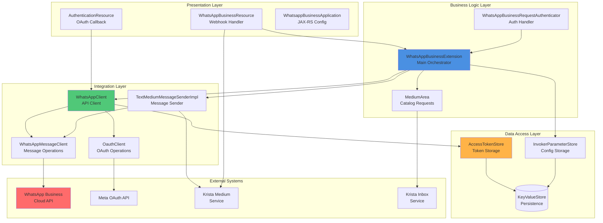
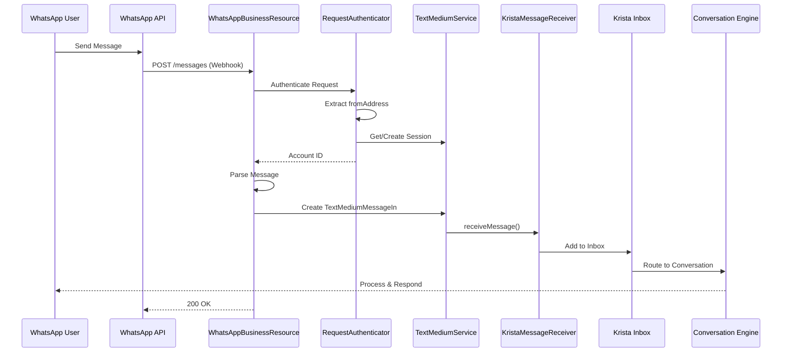
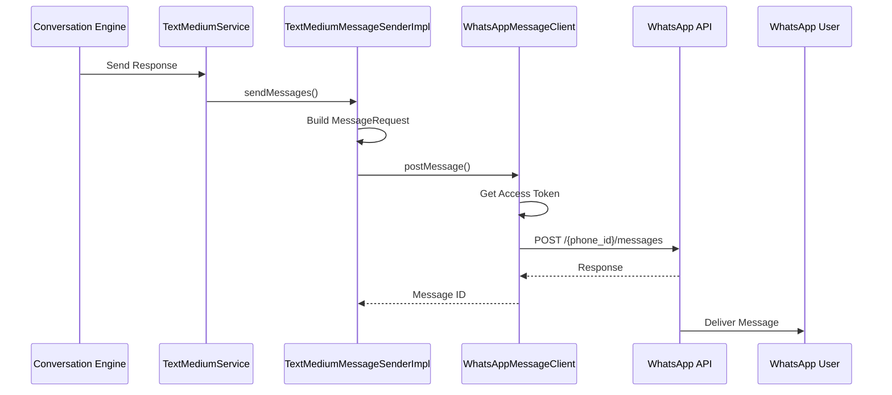
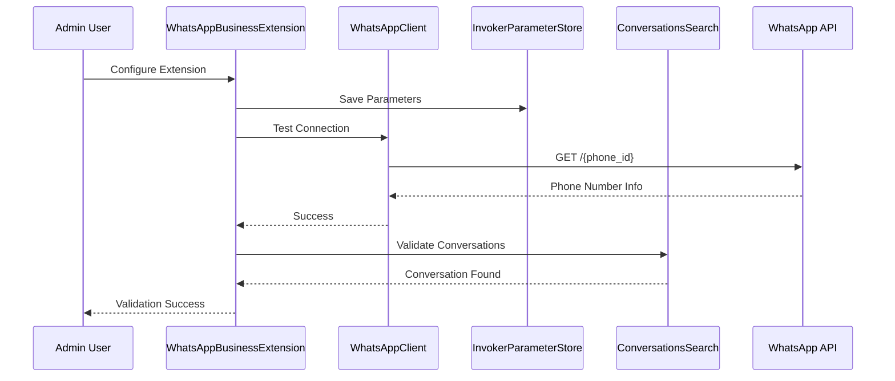
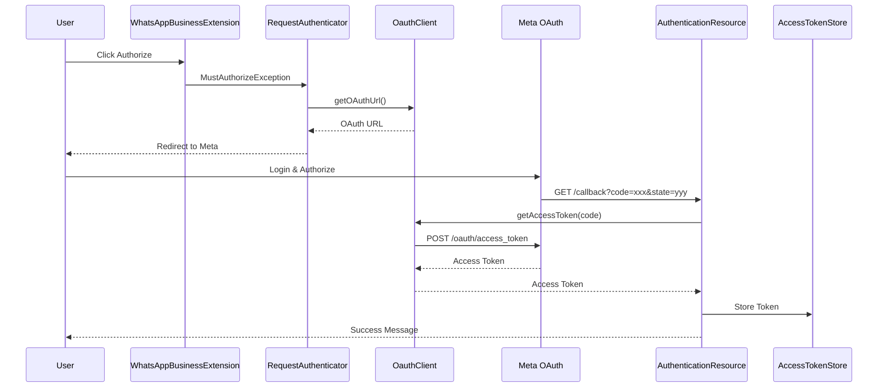
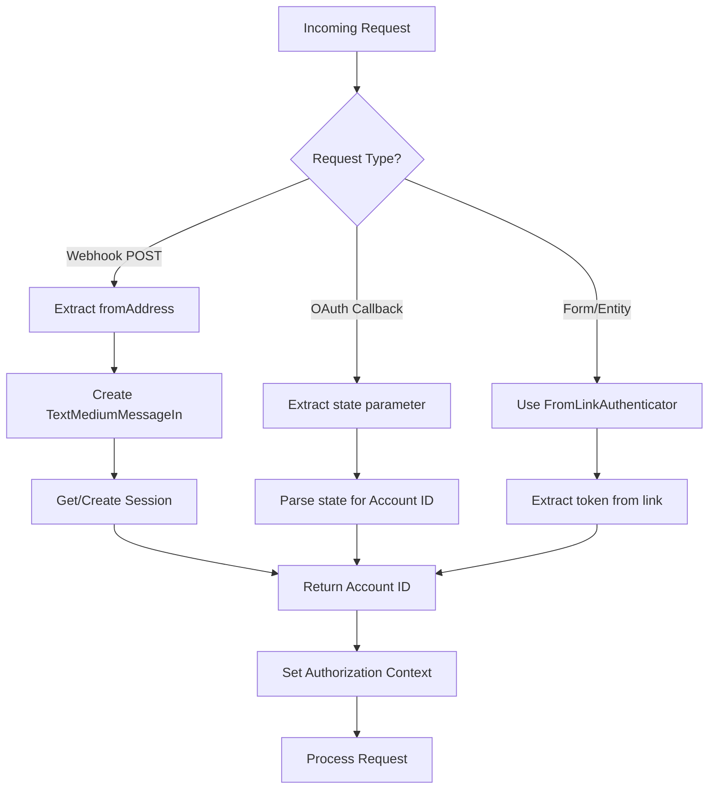
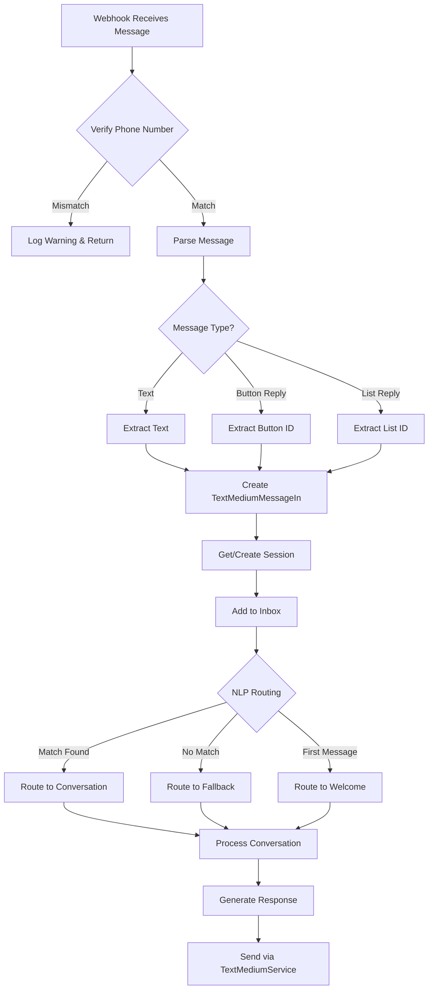
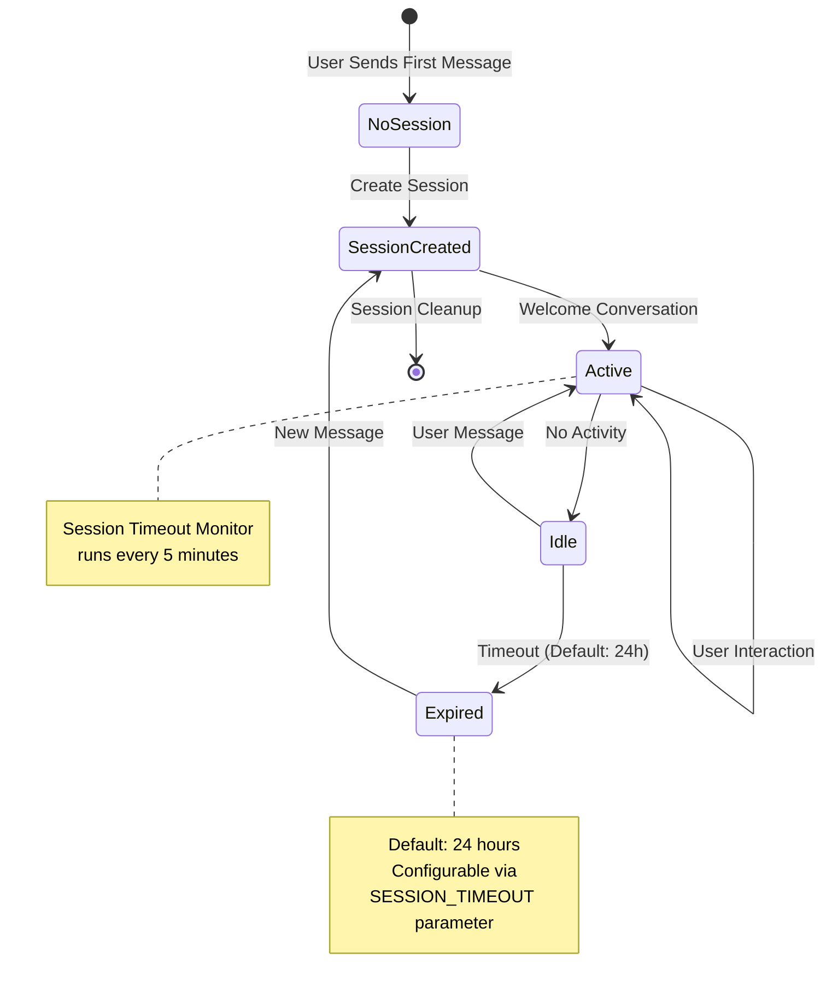
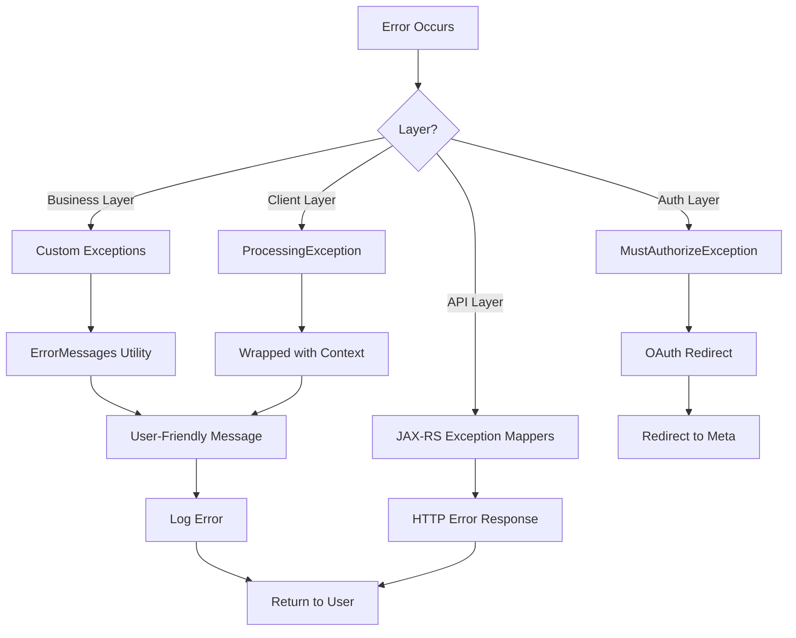
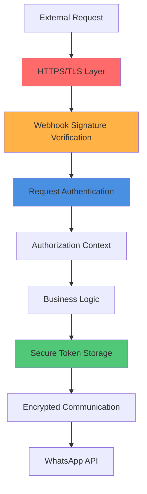

# WhatsApp Business Extension - Architecture Documentation

## Table of Contents

1. [Overview](#overview)
2. [Architecture Layers](#architecture-layers)
3. [Component Architecture](#component-architecture)
4. [Data Flow Architecture](#data-flow-architecture)
5. [Authentication Flow](#authentication-flow)
6. [Message Processing Flow](#message-processing-flow)
7. [Performance Considerations](#performance-considerations)
8. [Error Handling Architecture](#error-handling-architecture)
9. [Scalability and Limitations](#scalability-and-limitations)
10. [Security Architecture](#security-architecture)

---

## Overview

The WhatsApp Business Extension is a multi-layered Java application that integrates Krista with WhatsApp Business Cloud API. It follows a clean architecture pattern with clear separation of concerns across presentation, business logic, and data access layers.

### Key Architectural Principles

- **Separation of Concerns**: Clear boundaries between API, business logic, and data layers
- **Dependency Injection**: Uses HK2 for dependency management
- **Stateless Design**: Extension operates in a stateless manner with external state management
- **Event-Driven**: Webhook-based message reception with asynchronous processing
- **OAuth 2.0 Security**: Secure authentication using Meta's OAuth framework

### Technology Stack

| Component | Technology | Version |
|-----------|-----------|---------|
| Language | Java | 21 |
| Framework | JAX-RS (Jersey) | 2.x |
| DI Container | HK2 | 2.x |
| HTTP Client | JAX-RS Client | 2.x |
| JSON Processing | Gson | Custom |
| Logging | SLF4J | 1.x |
| AOP | AspectJ | 1.x |

---

## Architecture Layers

The extension follows a layered architecture pattern with the following layers:

### 1. Presentation Layer (API Layer)

**Package**: `app.krista.extension.essentials.collaboration.waba.api`

**Components**:
- `WhatsappBusinessApplication` - JAX-RS Application configuration
- `WhatsAppBusinessResource` - Webhook endpoint for incoming messages
- `AuthenticationResource` - OAuth callback endpoint

**Responsibilities**:
- HTTP request/response handling
- Webhook verification and message reception
- OAuth callback processing
- Request validation and error handling

### 2. Business Logic Layer (Service Layer)

**Package**: `app.krista.extension.essentials.collaboration.waba`

**Components**:
- `WhatsAppBusinessExtension` - Main extension class and orchestrator
- `WhatsAppBusinessRequestAuthenticator` - Authentication and authorization logic
- `catalog.MediumArea` - Catalog request implementations

**Responsibilities**:
- Extension lifecycle management
- Business rule validation
- Session management
- Conversation routing
- Message transformation

### 3. Integration Layer (Client Layer)

**Package**: `app.krista.extension.essentials.collaboration.waba.client`

**Components**:
- `WhatsAppClient` - Main client for WhatsApp Business API
- `WhatsAppMessageClient` - Message sending operations
- `OauthClient` - OAuth authentication operations
- `TextMediumMessageSenderImpl` - Medium service integration

**Responsibilities**:
- External API communication
- HTTP request construction
- Response parsing
- Connection management
- Error handling for API calls

### 4. Data Access Layer (Store Layer)

**Package**: `app.krista.extension.essentials.collaboration.waba.store`

**Components**:
- `AccessTokenStore` - OAuth token persistence
- `InvokerParameterStore` - Extension configuration persistence

**Responsibilities**:
- Data persistence using KeyValueStore
- Token management
- Configuration storage and retrieval

### 5. Domain Model Layer

**Packages**:
- `app.krista.extension.essentials.collaboration.waba.request`
- `app.krista.extension.essentials.collaboration.waba.whatsapp`

**Components**:
- `MessageRequest` - Outgoing message models
- `WhatsAppReceivedMessage` - Incoming message models
- Request builders and parameter objects

**Responsibilities**:
- Domain object definitions
- Message structure representation
- Builder patterns for complex objects

### 6. Utility Layer

**Package**: `app.krista.extension.essentials.collaboration.waba.util`

**Components**:
- `ErrorMessages` - Centralized error message management
- `Constants` - Application constants
- `PerformanceLogging` - AOP-based performance monitoring
- `InvokerParameters` - Parameter definitions

**Responsibilities**:
- Cross-cutting concerns
- Utility functions
- Constants management
- Performance monitoring

---

## Component Architecture



### Component Interaction Patterns

#### 1. Dependency Injection Pattern

All components use constructor-based dependency injection via HK2:

```java
@Inject
public WhatsAppBusinessExtension(
    AuthorizationContext authorizationContext,
    KeyValueStore keyValueStore,
    @Named(InvokerParameters.PHONE_NUMBER_ID) InvokerAttributeProvider<String> phoneNumberId,
    AuthenticationSettings authenticationSettings,
    Invoker invoker,
    RequestContext requestContext)
```

#### 2. Store Pattern

Data persistence uses a store abstraction over KeyValueStore:

```java
AccessTokenStore.create(keyValueStore)
    .put(phoneNumberId, accessToken)
    .get(phoneNumberId)
```

#### 3. Client Pattern

API clients encapsulate external communication:

```java
WhatsAppClient → WhatsAppMessageClient → WhatsApp Business API
WhatsAppClient → OauthClient → Meta OAuth API
```

#### 4. Builder Pattern

Complex message requests use builder pattern:

```java
new TextMessageRequestBuilderImpl()
    .to(targetAddress)
    .text(messageText)
    .previewUrl(false)
    .build()
```

---

## Data Flow Architecture

### Incoming Message Flow (Webhook)



### Outgoing Message Flow



### Configuration and Validation Flow



---

## Authentication Flow

### OAuth 2.0 Authorization Flow



### Request Authentication Flow



---

## Message Processing Flow

### Webhook Message Processing



### Session Management Flow



---

## Performance Considerations

### Performance Characteristics

| Operation | Average Time | Notes |
|-----------|-------------|-------|
| Webhook Message Reception | < 100ms | Asynchronous processing |
| Message Sending | 200-500ms | Depends on WhatsApp API |
| OAuth Token Exchange | 1-2s | One-time operation |
| Session Lookup | < 50ms | In-memory cache |
| NLP Conversation Matching | 15-20s | Known performance issue (KR-12472) |
| Inbox Message Retrieval | 100-500ms | Depends on message history size |

### Performance Optimization Strategies

#### 1. Asynchronous Processing

```java
// Webhook processing is non-blocking
@POST
@Path("messages")
public Response receiveMessage(String payload) {
    // Quick validation and queuing
    mediumMessageReceiver.receiveMessage(messageIn);
    return Response.ok().build(); // Return immediately
}
```

#### 2. Connection Pooling

- JAX-RS Client uses connection pooling by default
- Reuses HTTP connections to WhatsApp API
- Reduces connection overhead

#### 3. Token Caching

```java
// Access tokens cached in KeyValueStore
// Avoids repeated OAuth flows
accessTokenStore.get(phoneNumberId)
```

#### 4. Batch Message Retrieval

```java
// Retrieves messages in batches of 20
inbox.getMessages(offset, offset == null, -20)
```

#### 5. Performance Logging (AOP)

```java
@Around("execution(public * ...sendMessages(..))")
public Object logPerformance(ProceedingJoinPoint pjp) {
    long start = System.currentTimeMillis();
    Object result = pjp.proceed();
    long duration = System.currentTimeMillis() - start;
    perfLogger.info("Duration: {}ms", duration);
    return result;
}
```

### Performance Limitations

#### 1. WhatsApp API Rate Limits

| Account Type | Limit | Impact |
|-------------|-------|--------|
| Test Phone Number | 5 recipients | Development only |
| Unverified Business | 250 conversations/24h | Small deployments |
| Verified Business | 1,000+ conversations/24h | Production use |

#### 2. Message Size Limits

- Text messages: 4,096 characters
- Button text: 20 characters
- Maximum buttons: 3 per message
- List items: 10 per message

#### 3. Session Timeout

- Default: 24 hours (configurable)
- Monitor runs every 5 minutes
- Expired sessions cleaned up automatically

#### 4. NLP Search Performance

- **Known Issue (KR-12472)**: NLP search takes ~20 seconds
- **Impact**: Initial conversation routing delay
- **Mitigation**:
  - Pre-configure common conversations
  - Use specific keywords
  - Implement caching for frequent queries

#### 5. Message History Retrieval

- Batch size: 20 messages
- Large histories require multiple iterations
- Performance degrades with message volume
- **Mitigation**: Implement result caching

---

## Error Handling Architecture

### Error Handling Layers



### Exception Hierarchy

```
Throwable
├── Exception
│   ├── RuntimeException
│   │   ├── IllegalStateException (API Connection Errors)
│   │   ├── IllegalArgumentException (Validation Errors)
│   │   ├── ProcessingException (JAX-RS Client Errors)
│   │   └── MustAuthorizeException (Auth Required)
│   └── Checked Exceptions
│       ├── MissingResourceException (Missing Parameters)
│       └── BadRequestException (Invalid Requests)
```

### Error Message Categories

| Category | Error Type | User Action |
|----------|-----------|-------------|
| Authentication | AUTH_NOT_AUTHENTICATED | Complete OAuth flow |
| Authentication | AUTH_TOKEN_EXPIRED | Re-authenticate |
| Configuration | CONFIG_PHONE_NUMBER_MISSING | Provide Phone Number ID |
| Configuration | CONVERSATION_NOT_FOUND | Create conversation |
| Webhook | WEBHOOK_VERIFICATION_FAILED | Check verify token |
| API Communication | API_CONNECTION_ERROR | Check network/credentials |
| Message Processing | MESSAGE_PROCESSING_ERROR | Review message format |
| Session | SESSION_NOT_FOUND | User sends new message |


### Error Recovery Strategies

#### 1. Automatic Retry (Client Layer)

```java
// WhatsApp API retries webhook delivery
// Extension should be idempotent
```

#### 2. Graceful Degradation

```java
// Return empty string instead of null
public String getLastUserMessage() {
    // ... search logic
    return ""; // Graceful fallback
}
```

#### 3. Circuit Breaker Pattern

- Not currently implemented
- Recommended for production deployments
- Prevents cascade failures

#### 4. Error Logging and Monitoring

```java
logger.error(ErrorMessages.messageProcessingError(messageId, details), cause);
```

---

## Scalability and Limitations

### Scalability Characteristics

#### Horizontal Scalability

✅ **Stateless Design**: Extension can be deployed across multiple instances
✅ **Shared Storage**: KeyValueStore provides shared state
✅ **Webhook Distribution**: WhatsApp can distribute webhooks across instances
⚠️ **Session Affinity**: Not required but recommended for performance

#### Vertical Scalability

✅ **Thread-Safe**: Components designed for concurrent access
✅ **Connection Pooling**: Efficient resource utilization
⚠️ **Memory Usage**: Grows with active sessions

### Deployment Topologies

#### Single Instance Deployment

```
┌─────────────────────────────────┐
│   Krista Application Server     │
│  ┌───────────────────────────┐  │
│  │ WhatsApp Business Ext     │  │
│  │  - Webhook Handler        │  │
│  │  - Message Processor      │  │
│  │  - Session Manager        │  │
│  └───────────────────────────┘  │
└─────────────────────────────────┘
         │
         ↓
┌─────────────────────────────────┐
│   WhatsApp Business Cloud API   │
└─────────────────────────────────┘
```

**Pros**: Simple setup, easy debugging
**Cons**: Single point of failure, limited throughput
**Recommended For**: Development, small deployments (< 100 conversations/day)

#### Multi-Instance Deployment (Load Balanced)

```
                    ┌─────────────┐
                    │ Load        │
                    │ Balancer    │
                    └──────┬──────┘
                           │
        ┌──────────────────┼──────────────────┐
        │                  │                  │
        ↓                  ↓                  ↓
┌───────────────┐  ┌───────────────┐  ┌───────────────┐
│  Instance 1   │  │  Instance 2   │  │  Instance 3   │
│  WA Extension │  │  WA Extension │  │  WA Extension │
└───────────────┘  └───────────────┘  └───────────────┘
        │                  │                  │
        └──────────────────┼──────────────────┘
                           │
                           ↓
                  ┌─────────────────┐
                  │  Shared Storage │
                  │  (KeyValueStore)│
                  └─────────────────┘
```

**Pros**: High availability, better throughput
**Cons**: Complex setup, requires shared storage
**Recommended For**: Production deployments (> 100 conversations/day)

### Resource Requirements

| Deployment Size | Instances | Memory/Instance | CPU/Instance | Storage |
|----------------|-----------|-----------------|--------------|---------|
| Small (< 100 conv/day) | 1 | 2 GB | 2 cores | 10 GB |
| Medium (100-500 conv/day) | 2-3 | 4 GB | 4 cores | 50 GB |
| Large (500-1000 conv/day) | 3-5 | 8 GB | 8 cores | 100 GB |
| Enterprise (> 1000 conv/day) | 5+ | 16 GB | 16 cores | 500 GB |

### Capacity Planning

#### Message Throughput

- **Incoming**: 100-200 messages/second (per instance)
- **Outgoing**: 50-100 messages/second (limited by WhatsApp API)
- **Concurrent Sessions**: 1,000-5,000 (per instance)

#### Storage Growth

- **Access Tokens**: ~500 bytes per phone number
- **Session Data**: ~2 KB per active session
- **Configuration**: ~1 KB per extension instance
- **Message History**: Managed by Krista Inbox (external)

**Estimated Storage**:
- 1,000 active sessions = ~2 MB
- 10,000 active sessions = ~20 MB
- Storage growth is linear with active sessions

---

## Security Architecture

### Security Layers



### Security Features

#### 1. OAuth 2.0 Authentication

- **Authorization Code Flow**: Secure token exchange
- **State Parameter**: CSRF protection
- **Token Storage**: Encrypted in KeyValueStore
- **Token Expiration**: 60-day validity

#### 2. Webhook Security

- **HTTPS Required**: All webhook URLs must use HTTPS
- **Verify Token**: Shared secret for webhook verification
- **Signature Validation**: (Recommended but not implemented)
- **Phone Number Validation**: Ensures correct extension receives message

#### 3. Data Protection

- **Secure Fields**: Client Secret and Verify Token marked as `isSecured = true`
- **Token Encryption**: Access tokens encrypted at rest
- **No Plaintext Logging**: Sensitive data not logged

#### 4. Access Control

- **Workspace Admin Rights**: Required for extension configuration
- **Account-Based Authorization**: Each user authenticated separately
- **Session Isolation**: Users cannot access other sessions

#### 5. Input Validation

```java
// Validation at multiple layers
if (Objects.isNull(code)) {
    throw new MissingResourceException(ErrorMessages.AUTH_MISSING_CODE, ...);
}

if (Objects.isNull(invokerParameters)) {
    throw new BadRequestException(ErrorMessages.AUTH_INVALID_STATE);
}
```


### Security Best Practices

#### Configuration

✅ Use strong, random verify tokens
✅ Rotate access tokens regularly (before 60-day expiration)
✅ Use HTTPS for all webhook URLs
✅ Restrict webhook URL access to Meta IP ranges
✅ Enable workspace admin rights requirement

#### Deployment

✅ Use secure KeyValueStore implementation
✅ Enable TLS 1.2+ for all external communication
✅ Implement rate limiting at load balancer
✅ Monitor for suspicious activity
✅ Regular security audits

#### Development

✅ Never log sensitive data (tokens, secrets)
✅ Use parameterized queries (if applicable)
✅ Validate all user inputs
✅ Implement proper error handling
✅ Follow secure coding guidelines

### Threat Model

| Threat | Mitigation | Status |
|--------|-----------|--------|
| MITM Attack | HTTPS/TLS | ✅ Implemented |
| Token Theft | Encrypted storage | ✅ Implemented |
| CSRF | State parameter | ✅ Implemented |
| Replay Attack | Idempotent design | ✅ Implemented |
| Injection Attack | Input validation | ✅ Implemented |
| DoS Attack | Rate limiting | ⚠️ Recommended |
| Webhook Spoofing | Signature validation | ⚠️ Recommended |

---

## Appendix

### Key Design Decisions

1. **Stateless Extension**: Chose stateless design for scalability
2. **KeyValueStore**: Used for persistence to leverage Krista infrastructure
3. **JAX-RS**: Standard Java REST framework for API endpoints
4. **HK2 DI**: Integrated with Krista's dependency injection
5. **TextMediumService**: Leveraged existing Krista omni-channel framework
6. **Builder Pattern**: For complex message construction
7. **AOP Logging**: Non-invasive performance monitoring

### Future Enhancements

1. **Webhook Signature Validation**: Implement Meta's signature verification
2. **Circuit Breaker**: Add resilience patterns for API calls
3. **Message Queue**: Decouple webhook reception from processing
4. **Caching Layer**: Redis/Memcached for session and conversation caching
5. **Metrics Dashboard**: Real-time monitoring and analytics
6. **Auto Token Refresh**: Implement long-lived token refresh
7. **Multi-Region Support**: Deploy across geographic regions

### Component Dependency Matrix

| Component | Dependencies | Used By |
|-----------|-------------|---------|
| WhatsAppBusinessExtension | AuthorizationContext, KeyValueStore, Invoker | - |
| WhatsAppClient | AccessTokenStore, InvokerAttributeProvider | WhatsAppBusinessExtension |
| WhatsAppMessageClient | WhatsAppClient, AccessTokenStore | TextMediumMessageSenderImpl |
| OauthClient | - | WhatsAppClient |
| AccessTokenStore | KeyValueStore | WhatsAppClient, AuthenticationResource |
| InvokerParameterStore | KeyValueStore, Invoker | WhatsAppBusinessExtension |
| MediumArea | AuthorizationContext, InboxManager | - |
| WhatsAppBusinessResource | MediumMessageReceiver | - |
| AuthenticationResource | WhatsAppClient, AccessTokenStore | - |

### API Endpoints

| Endpoint | Method | Purpose | Authentication |
|----------|--------|---------|----------------|
| `/messages` | POST | Webhook for incoming messages | Phone Number Validation |
| `/messages` | GET | Webhook verification | Verify Token |
| `/callback` | GET | OAuth callback | State Parameter |
| `/form/*` | GET/POST | Complex field forms | Link Token |
| `/entity/*` | GET/POST | Entity search | Link Token |
| `/workspace/*` | GET | Workspace info | Link Token |

### Configuration Parameters

| Parameter | Type | Required | Secured | Default | Description |
|-----------|------|----------|---------|---------|-------------|
| USER_IDENTIFIER | Text | Yes | No | - | User identifier field |
| PHONE_NUMBER_ID | Text | Yes | No | - | WhatsApp Business Phone Number ID |
| CLIENT_ID | Text | Yes | No | - | Meta App Client ID |
| CLIENT_SECRET | Text | Yes | Yes | - | Meta App Client Secret |
| VERIFY_TOKEN | Text | Yes | Yes | - | Webhook verification token |
| WELCOME_CONVERSATION | Text | Yes | No | - | Initial conversation name |
| CONFIG_JSON | Text | No | No | - | Additional configuration JSON |
| GUEST_ROLE | Text | No | No | - | Role for guest users |
| FALLBACK_CONVERSATION | Text | No | No | - | Fallback conversation name |
| SESSION_TIMEOUT | Number | No | No | 24h | Session timeout in hours |

### Monitoring and Observability

#### Key Metrics to Monitor

1. **Message Throughput**
   - Incoming messages per second
   - Outgoing messages per second
   - Message processing latency

2. **API Performance**
   - WhatsApp API response time
   - OAuth token exchange time
   - API error rate

3. **Session Metrics**
   - Active sessions count
   - Session creation rate
   - Session expiration rate

4. **Error Rates**
   - Authentication failures
   - Webhook verification failures
   - Message processing errors
   - API communication errors

5. **Resource Utilization**
   - Memory usage
   - CPU usage
   - Storage usage
   - Connection pool utilization

#### Logging Strategy

```java
// Performance logging (AOP)
@Around("execution(* sendMessages(..))")
perfLogger.info("Duration: {}ms", duration);

// Error logging
logger.error(ErrorMessages.messageProcessingError(id, details), cause);

// Debug logging
logger.debug(ErrorMessages.debugMessageProcessed(messageId));

// Warning logging
logger.warn(ErrorMessages.webhookWrongInvoker(phone, phoneId));
```

### References

- [WhatsApp Business Cloud API Documentation](https://developers.facebook.com/docs/whatsapp/cloud-api)
- [Meta OAuth Documentation](https://developers.facebook.com/docs/facebook-login)
- [JAX-RS Specification](https://jakarta.ee/specifications/restful-ws/)
- [HK2 Dependency Injection](https://javaee.github.io/hk2/)
- [Krista Extension Development Guide](https://docs.krista.ai)
- [Error Messages Documentation](../src/main/resources/docs/pages/ErrorMessages.md)

---

**Document Version**: 1.0
**Last Updated**: 2025-11-28
**Author**: Architecture Team
**Status**: Published

