# Creating WhatsApp Business App

## Overview

This guide provides step-by-step instructions for creating and configuring a WhatsApp Business application in the Meta Developer Portal. This is a prerequisite for using the Krista WhatsApp Business Extension.

## Prerequisites

Before you begin, ensure you have:

- ✅ A Meta (Facebook) account
- ✅ A registered Meta Developer account
- ✅ A Meta Business Portfolio with complete business details
- ✅ A WhatsApp Business account
- ✅ A verified phone number for WhatsApp Business

## What You Will Create

By following this guide, you will:

1. Register as a Meta Developer
2. Create a Meta Business App
3. Add WhatsApp Business as a product
4. Obtain Phone Number ID
5. Obtain Client ID and Client Secret
6. Configure OAuth redirect URIs
7. Set up a test phone number (optional)

## Step-by-Step Instructions

### Step 1: Register as Meta Developer

If you haven't already registered as a Meta Developer:

1. Go to [Meta for Developers](https://developers.facebook.com/)
2. Click **Get Started** in the top right corner
3. Log in with your Meta (Facebook) account
4. Complete the registration process:
   - Accept the Terms of Service
   - Verify your email address
   - Provide required information


> **📝 Note**: For detailed registration instructions, refer to [Meta's registration documentation](https://developers.facebook.com/docs/development/register/).

### Step 2: Create Business Portfolio

Before creating an app, you need a business portfolio:

1. Go to [Meta Business Suite](https://business.facebook.com/)
2. Click **Create Account** or use an existing business account
3. Provide complete business details:
   - Business name
   - Business address
   - Business website
   - Business email
   - Business phone number
4. Verify your business information
5. Complete business verification (if required)

> **⚠️ Important**: Incomplete business details may prevent you from using WhatsApp Business API.

### Step 3: Create Meta Business App

1. Go to [My Apps](https://developers.facebook.com/apps) in Meta Developer Portal
2. Click **Create App** button

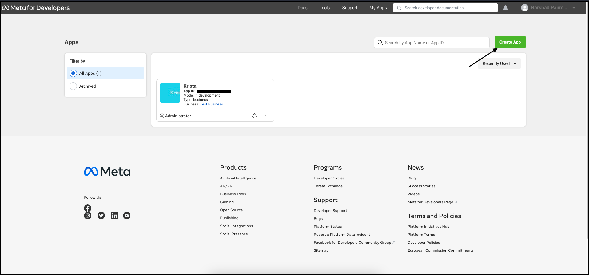

3. Select app type:
   - Choose **Business** as the app type
   - Click **Next**

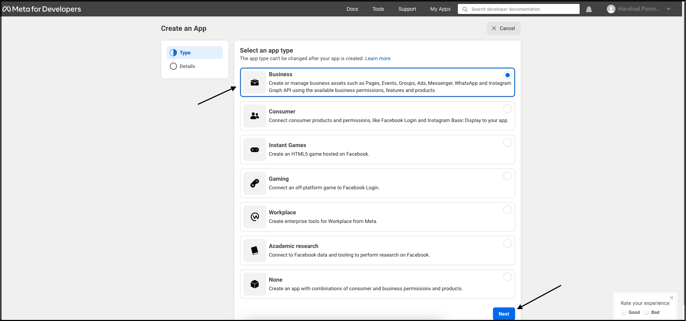

4. Provide app details:
   - **App Name**: Enter a descriptive name (e.g., "Krista WhatsApp Integration")
   - **App Contact Email**: Enter your business email
   - **Business Portfolio**: Select your business portfolio
   - Click **Create App**

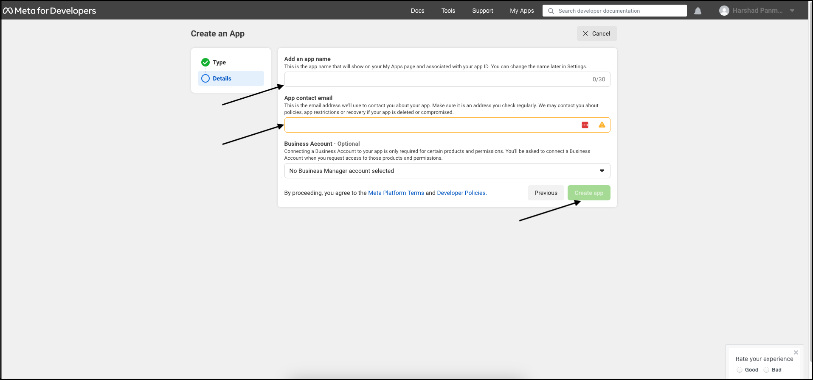

5. Complete security verification if prompted
6. Your app is now created and you'll be redirected to the App Dashboard

### Step 4: Add WhatsApp Business Product

1. From your App Dashboard, locate the **Add Products** section
2. Find **WhatsApp** in the product list
3. Click **Set Up** button next to WhatsApp

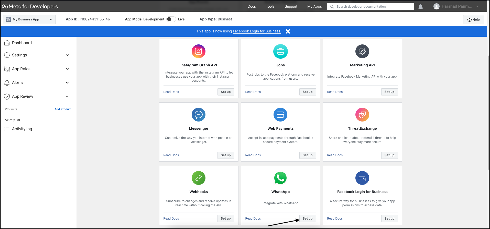

4. Select your business portfolio (if prompted)
5. Review and accept:
   - Facebook Terms for WhatsApp Business
   - Meta Hosting Terms for Cloud API
6. Click **Accept** to continue

### Step 5: Access WhatsApp Quick Start

After adding WhatsApp, you'll be redirected to the Quick Start page:

1. Click **Start using the API** button

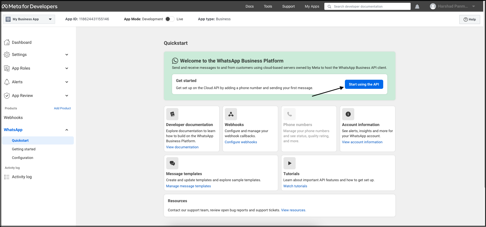

2. The Getting Started panel loads with:
   - Test phone number
   - Temporary access token
   - Phone Number ID
   - API version information

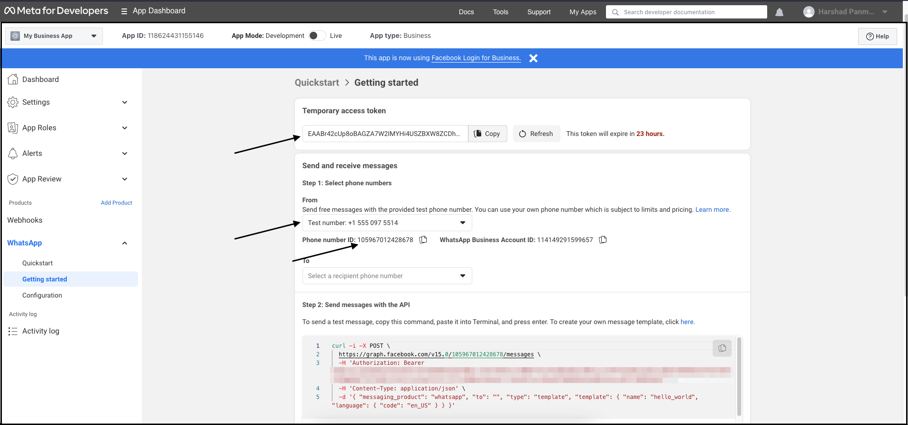

### Step 6: Obtain Phone Number ID

The Phone Number ID is required for extension configuration:

1. In the Getting Started panel, locate the **Phone Number ID** field
2. Copy the Phone Number ID value
3. Save this value - you'll need it for Krista extension configuration

**Example Phone Number ID**: `123456789012345`

> **📝 Note**: Each WhatsApp Business phone number has a unique Phone Number ID.

### Step 7: Add Production Phone Number (Optional)

The test phone number is limited to 5 recipients. For production use:

1. Scroll down in the Getting Started panel
2. Click **Add phone number** button
3. Follow the prompts to add your business phone number
4. Complete two-step verification for the phone number
5. Verify the phone number through SMS or voice call

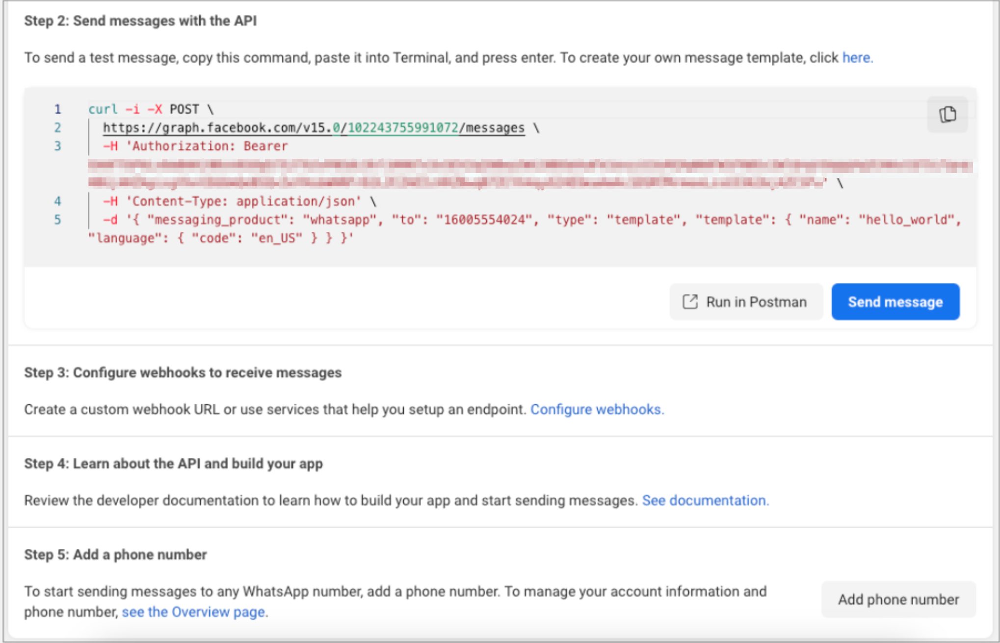

> **⚠️ Important**: After adding a production phone number, enable two-step verification for security.

### Step 8: Obtain Client ID and Client Secret

These OAuth credentials are required for authentication:

1. In the left sidebar, click **Settings**
2. Click **Basic** under Settings
3. Locate the **App ID** field:
   - This is your **Client ID**
   - Copy and save this value

4. Locate the **App Secret** field:
   - Click **Show** to reveal the secret
   - This is your **Client Secret**
   - Copy and save this value

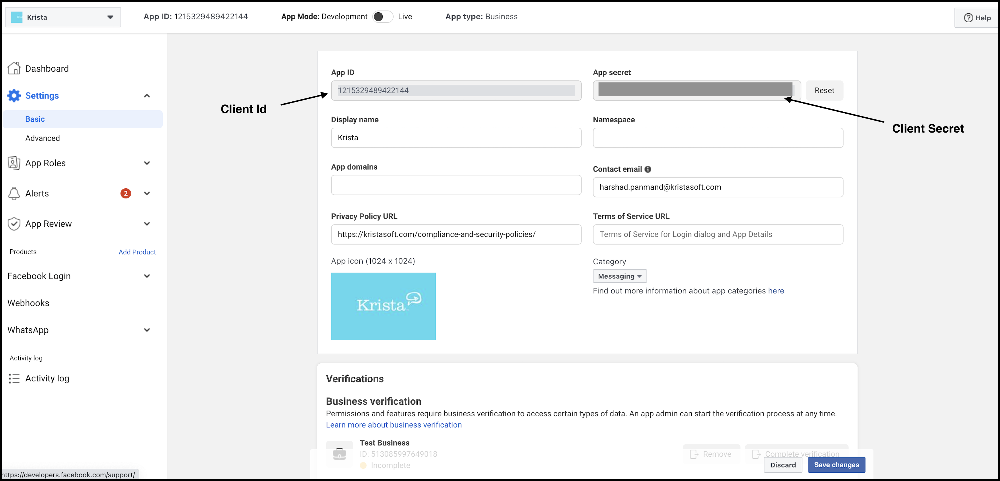

> **🔒 Security Warning**: Never share your App Secret. Store it securely and never commit it to version control.

### Step 9: Configure OAuth Redirect URI

The redirect URI is required for OAuth authentication flow:

1. In the left sidebar, click **Settings**
2. Click **Basic** under Settings
3. Scroll down to find **Add Platform** button
4. Click **Add Platform** and select **Website**
5. In the **Site URL** field, enter your Krista domain
6. Click **Save Changes**

7. Scroll down to **Facebook Login** section
8. Click **Settings** under Facebook Login for Business

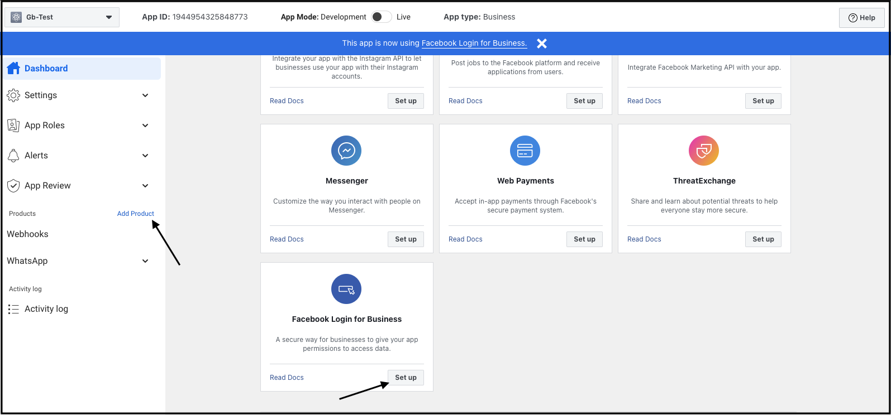

9. In **Valid OAuth Redirect URIs**, add:
   ```
   https://[your-krista-domain]/waba/callback
   ```
   Replace `[your-krista-domain]` with your actual Krista domain

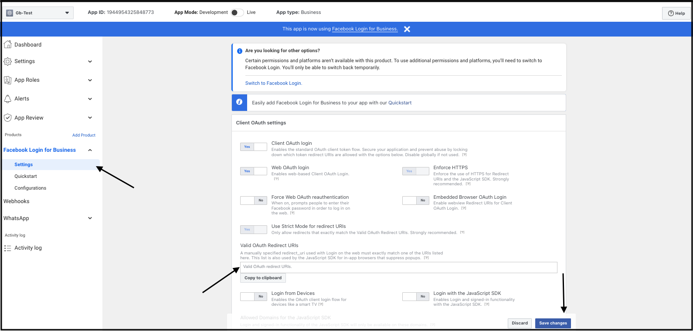

10. Click **Save Changes**

> **📝 Note**: The redirect URI must match exactly, including protocol (https://) and path (/waba/callback).

### Step 10: Configure Facebook Login for Business

To enable OAuth authentication:

1. In the left sidebar, find **Products**
2. Click **Facebook Login for Business**
3. Click **Settings**
4. Configure the following:
   - **Client OAuth Login**: Enable
   - **Web OAuth Login**: Enable
   - **Valid OAuth Redirect URIs**: Verify your callback URL is listed
5. Click **Save Changes**

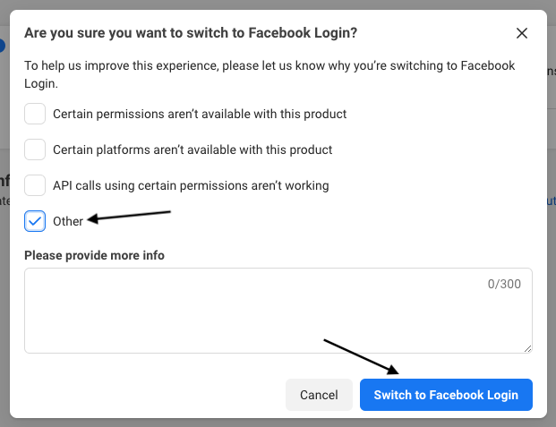

### Step 11: Subscribe to Webhook Events

To receive messages and events:

1. In the left sidebar, click **WhatsApp**
2. Click **Configuration**
3. Scroll to **Webhook** section
4. Click **Edit** button
5. You'll configure the webhook URL later in [WhatsApp Webhook Configuration](pages/WhatsAppWebhookConfiguration.md)

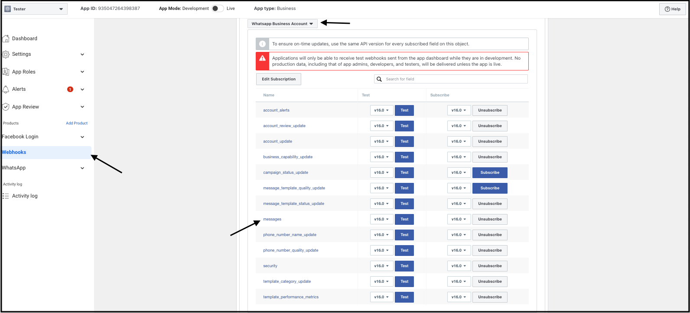

### Step 12: Set App Mode to Live (Production)

For production use, switch your app to Live mode:

1. In the top right corner of the App Dashboard, locate the app mode toggle
2. If it shows **Development**, click to switch to **Live**
3. Complete any required verification steps
4. Review and accept any additional terms

> **⚠️ Important**: Some features are only available in Live mode. Test thoroughly in Development mode first.

## Obtaining Permanent Access Token

The temporary access token expires after 24 hours. For production use, you need a permanent token:

### Option 1: System User Token (Recommended)

1. Go to [Meta Business Suite](https://business.facebook.com/)
2. Navigate to **Business Settings**
3. Click **Users** > **System Users**
4. Click **Add** to create a new system user
5. Assign the system user to your WhatsApp Business app
6. Generate a permanent access token with required permissions
7. Save the token securely

### Option 2: OAuth Flow (Used by Extension)

The Krista WhatsApp Business Extension uses OAuth 2.0 flow to obtain access tokens:
- User authenticates through Meta login
- Extension receives long-lived access token (60 days)
- Token is automatically managed by the extension

For detailed information, see [Authentication](pages/Authentication.md).

> **📝 Note**: For permanent token instructions, refer to [Meta's documentation](https://developers.facebook.com/docs/whatsapp/business-management-api/get-started#1--acquire-an-access-token-using-a-system-user-or-facebook-login).

## Verification

After completing all steps, verify your setup:

### Checklist

- [ ] Meta Developer account registered
- [ ] Business portfolio created with complete details
- [ ] Meta Business App created
- [ ] WhatsApp Business product added
- [ ] Phone Number ID obtained
- [ ] Client ID (App ID) obtained
- [ ] Client Secret (App Secret) obtained
- [ ] OAuth redirect URI configured
- [ ] Facebook Login for Business enabled
- [ ] Test phone number available (or production number added)

### Test Your Configuration

1. Use Meta's [Access Token Debugger](https://developers.facebook.com/tools/debug/accesstoken/)
2. Paste your access token (if you have one)
3. Verify:
   - Token is valid
   - App ID matches your Client ID
   - Scopes include required permissions

## Important Notes

### App Use Case

When creating your app, you may be asked to select a use case:

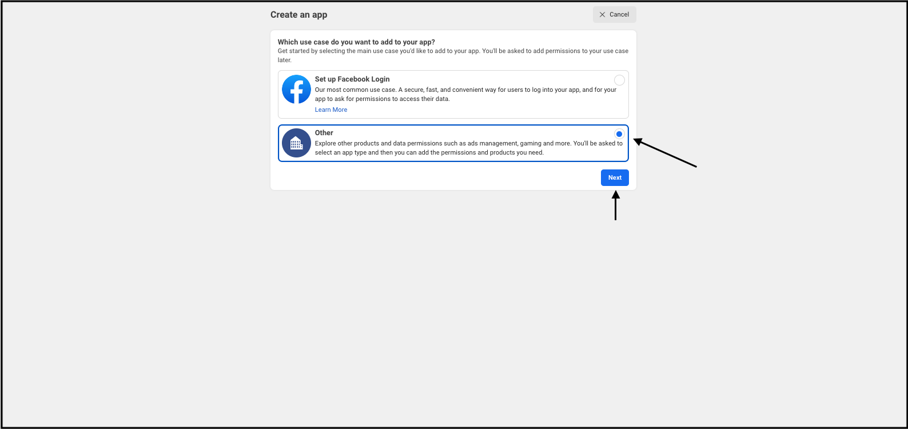

- Select **Other** or **Business Messaging**
- Provide a brief description of how you'll use WhatsApp Business
- This helps Meta understand your use case

### Business Verification

For production use with high message volumes:
- Complete Meta Business Verification
- Verify your business identity
- Provide required documentation
- This may take several days to complete

### Rate Limits

- **Test Phone Number**: Limited to 5 recipients
- **Unverified Business**: 250 conversations per 24 hours
- **Verified Business**: 1,000+ conversations per 24 hours (increases with quality rating)

### Quality Rating

WhatsApp assigns a quality rating to your phone number:
- **Green**: High quality, full messaging limits
- **Yellow**: Medium quality, reduced limits
- **Red**: Low quality, significantly reduced limits

Maintain high quality by:
- Responding to messages promptly
- Avoiding spam
- Respecting user preferences
- Following WhatsApp Business policies

## Troubleshooting

### Issue: Cannot Create App

**Cause**: Account not verified or incomplete registration

**Resolution**:
1. Complete Meta Developer registration
2. Verify your email address
3. Accept all required terms of service
4. Ensure you're logged in with correct account

### Issue: WhatsApp Product Not Available

**Cause**: Business portfolio not configured or app type incorrect

**Resolution**:
1. Ensure you created a **Business** app type
2. Complete business portfolio setup
3. Verify business details are complete
4. Try refreshing the page

### Issue: Cannot Add Phone Number

**Cause**: Phone number already in use or not eligible

**Resolution**:
1. Ensure phone number is not already registered with WhatsApp Business
2. Use a phone number that can receive SMS or voice calls
3. Verify the phone number is not a landline
4. Try a different phone number

### Issue: Redirect URI Not Saving

**Cause**: Invalid URL format or missing Facebook Login product

**Resolution**:
1. Ensure URL starts with https://
2. Verify URL format is correct
3. Add Facebook Login for Business product
4. Check for typos in the URL

## Next Steps

After successfully creating your WhatsApp Business app:

1. ✅ **[Configure Extension](pages/ExtensionConfiguration.md)**: Set up the extension in Krista
2. ✅ **[Set Up Authentication](pages/Authentication.md)**: Complete OAuth authentication
3. ✅ **[Configure Webhooks](pages/WhatsAppWebhookConfiguration.md)**: Set up webhook to receive messages
4. ✅ **[Test Connection](pages/ExtensionConfiguration.md#step-5-validate-configuration)**: Verify everything works

## See Also

- [Extension Configuration](pages/ExtensionConfiguration.md) - Configure the extension in Krista
- [Authentication](pages/Authentication.md) - OAuth 2.0 authentication details
- [WhatsApp Webhook Configuration](pages/WhatsAppWebhookConfiguration.md) - Set up webhooks
- [Meta Developer Documentation](https://developers.facebook.com/docs/development/create-an-app) - Official app creation guide
- [WhatsApp Business Platform](https://developers.facebook.com/docs/whatsapp) - Official WhatsApp documentation

