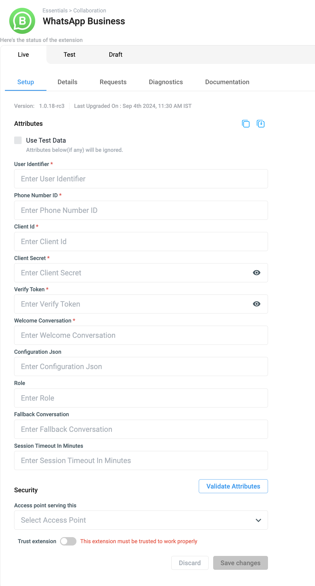

# Extension Configuration

## Overview

This guide provides detailed instructions for configuring the WhatsApp Business Extension in Krista. Proper configuration is essential for establishing secure communication between Krista and WhatsApp Business through the Meta Cloud API.

## Prerequisites

Before configuring the extension, ensure you have:

- ✅ Completed [Creating WhatsApp Business App](pages/CreatingWhatsAppBusinessApp.md)
- ✅ Obtained Phone Number ID from Meta Developer Portal
- ✅ Obtained Client ID and Client Secret from your WhatsApp Business app
- ✅ Created a Welcome Conversation in Krista
- ✅ Admin access to your Krista workspace

## Configuration Parameters

The following table describes all configuration parameters required for the WhatsApp Business Extension:

| Parameter | Type | Required | Description | Example |
|-----------|------|----------|-------------|---------|
| User Identifier | Text | Yes | Mobile number associated with WhatsApp Business account | "+1234567890" |
| Phone Number ID | Text | Yes | Unique identifier for your WhatsApp Business phone number from Meta | "123456789012345" |
| Client ID | Text | Yes | OAuth 2.0 client identifier from Meta app settings | "1234567890123456" |
| Client Secret | Text (Secured) | Yes | OAuth 2.0 client secret from Meta app settings | "abc123def456..." |
| Verify Token | Text (Secured) | Yes | Custom token for webhook verification (you create this) | "MySecureToken123" |
| Welcome Conversation | Text | Yes | Krista conversation to execute when a new session starts | "WhatsApp Welcome Flow" |
| Configuration JSON | Text | No | JSON payload to customize complex field appearance | See below |
| Guest Role | Text | No | Role assigned to external users without Krista accounts | "Guest User" |
| Fallback Conversation | Text | No | Conversation to execute when NLP finds no matches | "WhatsApp Fallback" |
| Session Timeout in Minutes | Number | No | Duration before inactive sessions expire | 30 |

### Configuration JSON Format

The Configuration JSON allows you to customize the appearance of complex fields (forms, buttons) in WhatsApp messages:

```json
{
  "title": "Krista",
  "icon": "https://your-domain.com/api/media/your-icon.png"
}
```

**Properties**:
- **title**: Display name shown in complex field headers
- **icon**: URL to icon image displayed in complex fields

## Step-by-Step Configuration

### Step 1: Access Extension Configuration

1. Log in to Krista as a workspace administrator
2. Navigate to **Extensions** in the workspace settings
3. Locate **WhatsApp Business Extension** in the Essentials > Collaboration domain
4. Click **Configure** to open the configuration panel



### Step 2: Configure Authentication Parameters

#### User Identifier
Enter the mobile number associated with your WhatsApp Business account:
- Must include country code (e.g., +1 for US)
- Format: "+[country code][phone number]"
- Example: "+12345678901"

#### Phone Number ID
Enter the Phone Number ID obtained from Meta Developer Portal:
1. Go to your WhatsApp Business app in Meta Developer Portal
2. Navigate to **WhatsApp > Getting Started**
3. Copy the **Phone Number ID** value
4. Paste into the configuration field

#### Client ID and Client Secret
Enter the OAuth credentials from your Meta app:
1. In Meta Developer Portal, go to **Settings > Basic**
2. Copy the **App ID** (this is your Client ID)
3. Copy the **App Secret** (this is your Client Secret)
4. Paste both values into the respective configuration fields

> **⚠️ Security Warning**: Never share your Client Secret. It provides full access to your WhatsApp Business account.

#### Verify Token
Create and enter a custom verify token:
- Use a strong, random string
- Store this token securely - you'll need it for webhook configuration
- Example: "MySecureVerifyToken2024"
- This token is used to verify webhook requests from Meta

### Step 3: Configure Conversation Settings

#### Welcome Conversation
Specify the Krista conversation to execute when users start a new session:
- Must be an existing conversation in your workspace
- Should be in the same execution mode (Live)
- Executed when:
  - A new session is created
  - No appropriate NLP results are found
- Example: "WhatsApp Welcome Flow"

> **📝 Note**: The conversation name must match exactly, including capitalization.

#### Fallback Conversation (Optional)
Specify a conversation to execute when NLP cannot find a match:
- Must be an existing conversation in your workspace
- Must be in the same execution mode as the extension
- Provides a better user experience when queries don't match any NLP intents
- Example: "WhatsApp Fallback Handler"

> **⚠️ Important**: For Test Mode or Draft Mode configurations, the fallback conversation must also be in Test or Draft mode respectively.

#### Guest Role (Optional)
Specify the role assigned to external users:
- External users are those without registered Krista accounts
- Guest users have limited access and privileges
- Must be an existing role in your workspace
- Example: "Guest User"

### Step 4: Configure Advanced Settings

#### Configuration JSON (Optional)
Customize the appearance of complex fields:

```json
{
  "title": "Krista Assistant",
  "icon": "https://studio.krista.app/api/media/krista-icon.png"
}
```

This configuration affects:
- Form headers in WhatsApp messages
- Button group titles
- Interactive message branding

#### Session Timeout in Minutes (Optional)
Configure automatic session expiration:
- Default: 30 minutes
- Range: 1-1440 minutes (24 hours)
- Sessions automatically expire after this period of inactivity
- Users must start a new session after timeout

### Step 5: Validate Configuration

1. Click **Validate Attributes** button
2. The system will verify:
   - ✅ Phone Number ID is valid
   - ✅ OAuth credentials are correct
   - ✅ Welcome Conversation exists
   - ✅ Fallback Conversation exists (if specified)
   - ✅ Connection to WhatsApp Business API is successful

If validation fails, review the error message and correct the configuration.

### Step 6: Configure Security Settings

1. In the **Security** panel, configure:
   - **Access Points**: Select the access points where the extension can run
   - **Trust Extension**: Enable the toggle to trust the extension
2. Click **Save Changes** to apply the configuration

> **🔒 Security Best Practice**: Only enable access points that are necessary for your use case.

## Redirect URI Configuration

The redirect URI is automatically generated by Krista and follows this format:

```
https://[your-krista-domain]/waba/callback
```

This URI is used for OAuth 2.0 authentication flow. You must configure this URI in your Meta app settings:

1. Go to Meta Developer Portal
2. Navigate to your app's **Settings > Basic**
3. Click **Add Platform** and select **Website**
4. Add the redirect URI to **Valid OAuth Redirect URIs**
5. Save changes

For detailed instructions, see [Authentication](pages/Authentication.md).

## Validation Rules

The extension validates the following during configuration:

| Validation | Error Message | Resolution |
|------------|---------------|------------|
| Phone Number ID is empty | "Phone Number ID is required" | Enter the Phone Number ID from Meta Developer Portal |
| Client ID is empty | "Client ID is required" | Enter the App ID from Meta app settings |
| Client Secret is empty | "Client Secret is required" | Enter the App Secret from Meta app settings |
| Verify Token is empty | "Verify Token is required" | Create and enter a custom verify token |
| Welcome Conversation is empty | "Welcome Conversation is required" | Enter the name of an existing conversation |
| Welcome Conversation not found | "Conversation '[name]' not found" | Verify the conversation exists and name is correct |
| Multiple Welcome Conversations found | "Ensure Welcome Conversation is unique" | Use a unique conversation name |
| Fallback Conversation not found | "Conversation '[name]' not found" | Verify the conversation exists and name is correct |
| Invalid OAuth credentials | "User is not Authenticated" | Verify Client ID and Client Secret are correct |
| Connection test failed | "Failed to connect to WhatsApp Business API" | Check network connectivity and credentials |

## Security Considerations

### Credential Protection

1. **Client Secret**:
   - Stored encrypted in Krista
   - Never logged or displayed after initial entry
   - Rotate periodically for enhanced security

2. **Verify Token**:
   - Stored encrypted in Krista
   - Required for webhook verification
   - Use a strong, random value

3. **Access Tokens**:
   - Automatically managed by the extension
   - Stored encrypted in Krista's key-value store
   - Refreshed automatically before expiration

### Access Control

- Extension requires workspace admin rights for configuration
- Only trusted administrators should have access to configuration
- Review and audit extension access regularly

### Network Security

- All communication with WhatsApp Business API uses HTTPS
- OAuth 2.0 provides secure authentication
- Webhook requests are verified using the Verify Token

## Troubleshooting

> 📖 **For comprehensive error messages and troubleshooting**: See the [Error Messages and Troubleshooting](pages/ErrorMessages.md) guide for detailed information about all error messages, their causes, and step-by-step resolution instructions.

### Common Configuration Issues

#### Issue: Authentication Errors

**Symptoms**:
- "Authentication required. Please complete the OAuth authentication process..."
- "Your authentication token has expired..."
- "Unable to verify your credentials with WhatsApp Business API..."

**Quick Resolution**:
1. Verify Client ID and Client Secret are correct
2. Check that the Phone Number ID is valid
3. Click the **Authorize** button and complete OAuth flow
4. Ensure your Meta app is active and not restricted

**Detailed Guide**: [Authentication Errors](pages/ErrorMessages.md#authentication-errors)

---

#### Issue: Conversation Validation Errors

**Symptoms**:
- "Conversation '[name]' not found..."
- "Multiple conversations with the same name found..."

**Quick Resolution**:
1. Verify the conversation exists in your workspace
2. Check that the conversation name matches exactly (case-sensitive)
3. Ensure the conversation is in Live execution mode
4. Rename duplicate conversations to make them unique

**Detailed Guide**: [Configuration Validation Errors](pages/ErrorMessages.md#configuration-validation-errors)

---

#### Issue: Webhook Configuration Errors

**Symptoms**:
- "Webhook verification failed. The verify token does not match..."
- Messages not being received
- Validation succeeds but messages don't send

**Quick Resolution**:
1. Complete [WhatsApp Webhook Configuration](pages/WhatsAppWebhookConfiguration.md)
2. Verify webhook URL is correct
3. Ensure Verify Token matches exactly in both Krista and Meta Developer Portal
4. Check that webhook subscriptions are active

**Detailed Guide**: [Webhook Errors](pages/ErrorMessages.md#webhook-errors)

---

#### Issue: API Communication Errors

**Symptoms**:
- "WhatsApp Business API request failed..."
- "Unable to connect to WhatsApp Business API..."

**Quick Resolution**:
1. Check your internet connection
2. Verify access token is valid (re-authenticate if needed)
3. Check Meta's status page for outages
4. Review firewall settings for graph.facebook.com

**Detailed Guide**: [API Communication Errors](pages/ErrorMessages.md#api-communication-errors)

---

#### Issue: Session Timeout Configuration

**Cause**: Session Timeout value not appropriate for use case

**Resolution**:
1. Adjust Session Timeout in Minutes value
2. Consider user interaction patterns
3. Balance between security and user experience
4. Test with actual users to find optimal value

## Next Steps

After successfully configuring the extension:

1. ✅ **[Configure Webhooks](pages/WhatsAppWebhookConfiguration.md)**: Set up webhooks to receive messages
2. ✅ **[Test Connection](pages/Authentication.md#testing-authentication)**: Verify the extension can communicate with WhatsApp
3. ✅ **[Review Workflow](pages/Workflow.md)**: Understand common use cases and workflows
4. ✅ **[Explore Catalog Requests](pages/GetSessionIdForActiveUser.md)**: Learn about available operations

## See Also

- [Authentication](pages/Authentication.md) - OAuth 2.0 authentication details
- [Creating WhatsApp Business App](pages/CreatingWhatsAppBusinessApp.md) - Setting up your Meta app
- [WhatsApp Webhook Configuration](pages/WhatsAppWebhookConfiguration.md) - Configuring webhooks
- [Workflow](pages/Workflow.md) - Common use cases and examples