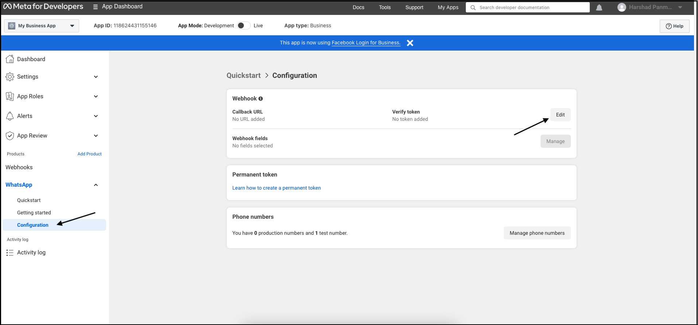
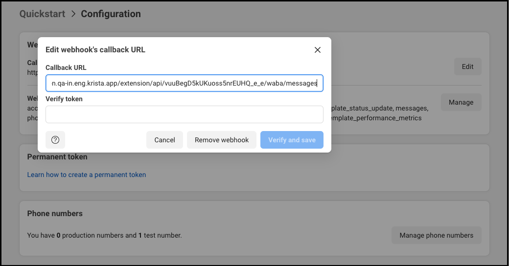
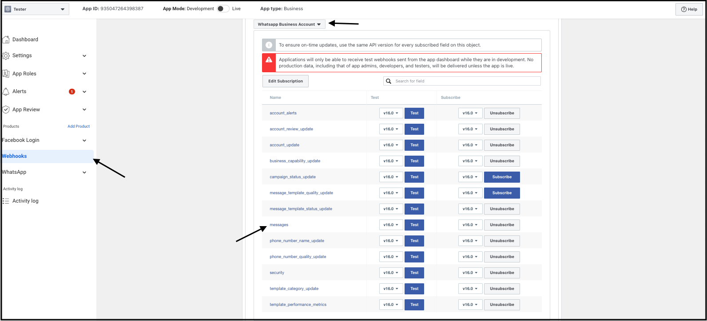

# WhatsApp Webhook Configuration

## Overview

Webhooks enable real-time communication between WhatsApp Business and Krista by allowing the extension to receive instant HTTP notifications when events occur, such as incoming messages, message status updates, and user interactions. Proper webhook configuration is essential for the extension to function correctly.

## Prerequisites

Before configuring webhooks, ensure you have:

- ✅ Completed [Creating WhatsApp Business App](pages/CreatingWhatsAppBusinessApp.md)
- ✅ Completed [Extension Configuration](pages/ExtensionConfiguration.md) in Krista
- ✅ Obtained the Verify Token from your extension configuration
- ✅ Access to Meta Developer Portal with your WhatsApp Business app

## What Are Webhooks?

Webhooks are automated HTTP callbacks that allow WhatsApp to send real-time notifications to Krista when specific events occur:

- **Incoming Messages**: When a user sends a message to your WhatsApp Business number
- **Message Status**: When message delivery status changes (sent, delivered, read)
- **User Actions**: When users interact with buttons, lists, or other interactive elements
- **System Events**: When system-level events occur (e.g., phone number changes)

## Webhook URL Format

The webhook URL for the Krista WhatsApp Business Extension follows this format:

```
https://[your-krista-domain]/waba/messages
```

**Example**:
```
https://studio.krista.app/waba/messages
```

**Components**:
- **Protocol**: Must be HTTPS (HTTP is not supported)
- **Domain**: Your Krista appliance domain
- **Path**: `/waba/messages` (fixed path for WhatsApp Business messages)

## Step-by-Step Configuration

### Step 1: Access Webhook Configuration

1. Log in to [Meta Developer Portal](https://developers.facebook.com/)
2. Navigate to [My Apps](https://developers.facebook.com/apps)
3. Select your WhatsApp Business application
4. In the left sidebar, click **WhatsApp**
5. Click **Configuration** under WhatsApp



### Step 2: Edit Webhook Settings

1. In the Webhook section, click **Edit** button
2. The webhook configuration dialog will open

### Step 3: Configure Callback URL

1. In the **Callback URL** field, enter your webhook URL:
   ```
   https://[your-krista-domain]/waba/messages
   ```

2. Replace `[your-krista-domain]` with your actual Krista domain

3. Ensure the URL:
   - Starts with `https://` (not http://)
   - Ends with `/waba/messages`
   - Is publicly accessible from the internet
   - Does not contain any typos

**Example**:
```
https://studio.krista.app/waba/messages
```

### Step 4: Configure Verify Token

1. In the **Verify Token** field, enter the exact token you configured in Krista's extension settings
2. This token must match exactly (case-sensitive)
3. The token is used by Meta to verify that the webhook endpoint belongs to you



> **⚠️ Important**: The Verify Token must match exactly with the token you entered in the Krista extension configuration. Any mismatch will cause webhook verification to fail.

### Step 5: Verify and Save

1. Click **Verify and Save** button
2. Meta will send a verification request to your webhook URL
3. Krista will respond with the verification challenge
4. If successful, you'll see a confirmation message
5. If verification fails, check:
   - Webhook URL is correct and accessible
   - Verify Token matches exactly
   - Krista extension is properly configured
   - Network connectivity is working

### Step 6: Subscribe to Webhook Fields

After webhook verification succeeds, you need to subscribe to specific webhook events:

1. Scroll down to the **Webhook fields** section
2. Click **Manage** button next to your phone number
3. Subscribe to the following fields:
   - ✅ **messages**: Receive incoming messages from users
   - ✅ **message_status**: Receive message delivery status updates (optional but recommended)
4. Click **Done** to save subscriptions



> **📝 Note**: The `messages` field is required for the extension to receive user messages. The `message_status` field is optional but recommended for tracking message delivery.

## Webhook Events

### Messages Event

Triggered when a user sends a message to your WhatsApp Business number.

**Event Data Includes**:
- Message text content
- Sender phone number
- Message timestamp
- Message type (text, image, document, etc.)
- Message ID

**Use Case**: Primary event for receiving user messages and triggering Krista conversations.

### Message Status Event

Triggered when the status of a sent message changes.

**Status Types**:
- **sent**: Message sent to WhatsApp servers
- **delivered**: Message delivered to user's device
- **read**: User has read the message
- **failed**: Message delivery failed

**Use Case**: Track message delivery and read receipts for analytics and user experience.

## Webhook Security

### Verification Process

When you configure the webhook, Meta performs a verification:

1. **Verification Request**: Meta sends a GET request to your webhook URL with:
   - `hub.mode`: "subscribe"
   - `hub.challenge`: Random string to echo back
   - `hub.verify_token`: Your verify token

2. **Krista Validation**: Krista extension:
   - Validates the verify token matches configuration
   - Returns the challenge string if valid
   - Rejects the request if token doesn't match

3. **Verification Success**: Meta confirms the webhook is valid and saves the configuration

### Signature Validation

For production security, Meta signs all webhook requests:

- Each webhook request includes an `X-Hub-Signature-256` header
- The signature is an HMAC SHA256 hash of the request body
- Krista extension validates this signature to ensure requests are from Meta
- Invalid signatures are rejected

### Best Practices

1. **Use HTTPS**: Always use HTTPS for webhook URLs (required by Meta)
2. **Secure Verify Token**: Use a strong, random verify token
3. **Validate Signatures**: Ensure signature validation is enabled
4. **Monitor Logs**: Regularly review webhook logs for suspicious activity
5. **Rate Limiting**: Implement rate limiting to prevent abuse
6. **Error Handling**: Handle webhook errors gracefully

## Testing Webhooks

### Test Message Flow

After configuration, test the webhook:

1. Send a test message to your WhatsApp Business number from your personal WhatsApp
2. Verify the message appears in Krista
3. Check that Krista responds appropriately
4. Verify the conversation flow works as expected

### Webhook Logs

Monitor webhook activity in Meta Developer Portal:

1. Go to your WhatsApp Business app
2. Click **WhatsApp** > **Configuration**
3. Scroll to **Webhook** section
4. Click **View Logs** to see recent webhook deliveries
5. Review for errors or failed deliveries

### Common Test Scenarios

1. **Simple Text Message**: Send "Hello" and verify Krista receives it
2. **Button Interaction**: Send a message that triggers buttons and click one
3. **Session Creation**: Verify new sessions are created for new users
4. **Welcome Conversation**: Verify welcome conversation is triggered
5. **NLP Matching**: Test various queries to verify NLP routing

## Troubleshooting

> 📖 **For comprehensive error messages and troubleshooting**: See the [Error Messages and Troubleshooting](pages/ErrorMessages.md) guide for detailed information about all error messages, their causes, and step-by-step resolution instructions.

### Common Webhook Issues

#### Issue: Webhook Verification Fails

**Symptoms**:
- "Webhook verification failed. The verify token does not match..."
- Meta Developer Portal shows verification error

**Quick Resolution**:
1. Verify the token in Krista extension configuration matches exactly
2. Check that webhook URL is correct and publicly accessible
3. Ensure Krista extension is running and configured
4. Test webhook URL accessibility from external network
5. Review Krista logs for verification request details

**Detailed Guide**: [Webhook Errors](pages/ErrorMessages.md#webhook-errors)

---

#### Issue: Messages Not Received in Krista

**Symptoms**:
- Messages sent to WhatsApp don't appear in Krista
- "Webhook message received for incorrect extension configuration..."

**Quick Resolution**:
1. Verify webhook is subscribed to `messages` field
2. Check webhook logs in Meta Developer Portal for errors
3. Verify webhook URL is correct
4. Ensure Krista extension is running
5. Test with a simple message
6. Review Krista logs for incoming webhook requests

**Detailed Guide**: [Webhook Errors](pages/ErrorMessages.md#webhook-errors)

---

### Issue: Webhook Requests Rejected

**Cause**: Signature validation failure or invalid request format

**Resolution**:
1. Verify webhook signature validation is working
2. Check that requests are coming from Meta's IP ranges
3. Review Krista logs for rejection reasons
4. Ensure webhook endpoint is processing requests correctly
5. Verify no proxy or firewall is modifying requests

### Issue: Delayed Message Delivery

**Cause**: Network latency or webhook processing delays

**Resolution**:
1. Check network connectivity between Meta and Krista
2. Review webhook processing performance in Krista
3. Monitor system resources (CPU, memory)
4. Check for any rate limiting or throttling
5. Review webhook logs for processing times

### Issue: Duplicate Messages Received

**Cause**: Webhook retry mechanism or configuration error

**Resolution**:
1. Implement idempotency in message processing
2. Check for duplicate webhook subscriptions
3. Verify webhook endpoint returns proper status codes
4. Review webhook logs for duplicate deliveries
5. Ensure message IDs are tracked to prevent duplicates

## Webhook Retry Mechanism

Meta implements automatic retry for failed webhook deliveries:

- **Retry Attempts**: Up to 3 retries
- **Retry Interval**: Exponential backoff (1s, 5s, 25s)
- **Success Criteria**: HTTP 200 status code
- **Failure Handling**: After 3 failed attempts, delivery is abandoned

**Best Practices**:
- Return HTTP 200 quickly (within 20 seconds)
- Process messages asynchronously if needed
- Implement idempotency to handle retries
- Log all webhook requests for debugging

## Monitoring and Maintenance

### Regular Checks

1. **Webhook Status**: Verify webhook is active and subscribed
2. **Delivery Success Rate**: Monitor webhook delivery success in Meta portal
3. **Error Logs**: Review error logs regularly
4. **Performance**: Monitor webhook processing performance
5. **Security**: Review security logs for suspicious activity

### Webhook Health Indicators

✅ **Healthy Webhook**:
- 100% verification success
- >99% delivery success rate
- <1 second average processing time
- No security violations

⚠️ **Unhealthy Webhook**:
- Verification failures
- <95% delivery success rate
- >5 second average processing time
- Security violations detected

## Advanced Configuration

### Multiple Phone Numbers

If you have multiple WhatsApp Business phone numbers:

1. Each phone number can use the same webhook URL
2. Krista extension handles routing based on phone number ID
3. Subscribe each phone number to webhook fields individually
4. Monitor webhook logs for each phone number separately

### Custom Webhook Processing

For advanced use cases, you can customize webhook processing:

1. Implement custom message filtering
2. Add custom logging or analytics
3. Integrate with external systems
4. Implement custom error handling

## See Also

- [Error Messages and Troubleshooting](pages/ErrorMessages.md) - Comprehensive error message guide
- [Extension Configuration](pages/ExtensionConfiguration.md) - Configure the extension and verify token
- [Creating WhatsApp Business App](pages/CreatingWhatsAppBusinessApp.md) - Set up your WhatsApp Business app
- [Authentication](pages/Authentication.md) - OAuth authentication details
- [Workflow](pages/Workflow.md) - Common use cases and workflows
- [Meta Webhook Documentation](https://developers.facebook.com/docs/whatsapp/webhooks) - Official webhook documentation